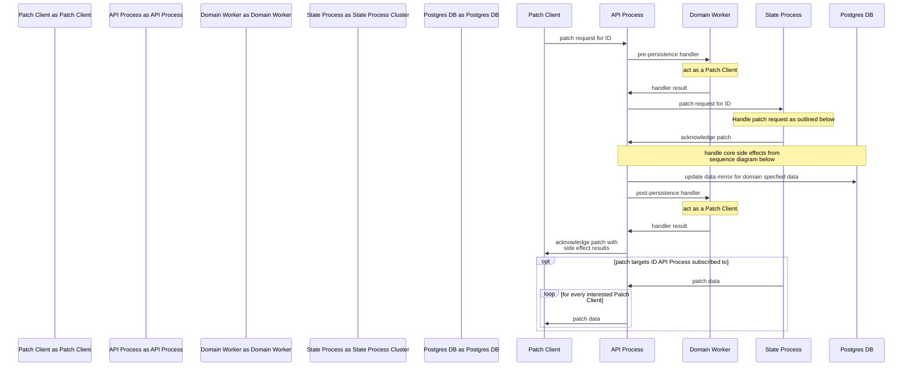
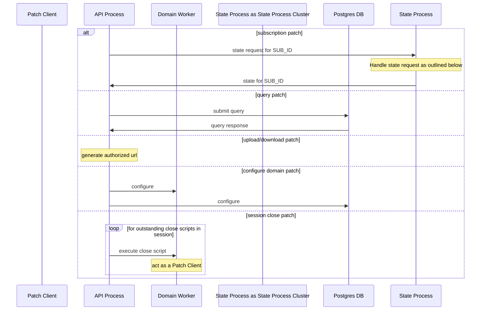

# Development

First install [docker](https://docs.docker.com/get-docker/),

```sh
# Deploy the core application in dev mode
sh core/develop.sh
```

# Deployment

To deploy you must install
[docker](https://docs.docker.com/get-docker/) and
[gcloud](https://cloud.google.com/sdk/docs/install).

## Auth

Use these commands to load required credentials into your
environment:

```sh
gcloud auth revoke
gcloud auth login web
gcloud config set project opensourcelearningplatform
```

## Setup

```sh
# Set CORS config for production bucket.
gcloud storage buckets update \
  gs://development-bucket-opensourcelearningplatform \
  --cors-file=core/infrastructure/CORS_CONFIG_FILE
```

## Publish

Production publish reads deployment secrets from `.credentials` at the repo
parent. Storage credentials are full server maps:

```sh
POSTGRES_SERVERS='{"default":{"host":"10.50.0.2","port":5432,"user":"postgres","password":"..."}}'
REDIS_SERVERS='{"default":{"host":"redis.example.com","port":15018,"username":"default","password":"..."}}'
REDIS_SUBSCRIPTION_SERVER='default' # optional
```

Core connects to each configured Redis server over TLS when `MODE=production`.
Use the Redis TLS port and a hostname covered by its publicly trusted certificate.

For clustered Redis, use a managed/proxy endpoint that routes commands to their
shards, such as Redis Cloud's standard endpoint. The current `createClient`
connections do not follow native Redis Cluster
`MOVED` redirects. Independent batches use bounded, nontransactional pipelines;
single-state updates retain their atomic transactions and Lua scripts.

```sh
bash core/infrastructure/GCP/publish production
bash core/infrastructure/GCP/publish production 1 3 6
bash core/infrastructure/GCP/publish production all
```

Select servers from the numbered menu, or pass numbers separated by spaces or
commas. Use `all` to deploy all nine servers. Each selected server deploys once,
in ascending server-number order, and finishes provisioning and startup before
the next server begins. Authentication and project selection happen once;
existing per-server confirmations and SSH retries still apply. Infrastructure
errors stop the deployment before proceeding to another server.

## Server logs

Download logs from any combination of the nine production servers listed in the
publish script. Run without arguments for a numbered menu, or pass server numbers
separated by spaces or commas. Use `all` to download from every server:

```sh
bash core/infrastructure/GCP/download-logs.sh
bash core/infrastructure/GCP/download-logs.sh 1 3 6
bash core/infrastructure/GCP/download-logs.sh all
```

The script uses the current gcloud project and saves a separate timestamped log
file for each selected server in your home directory.

## Idle restarts

Production API processes restart opportunistically after at least two hours of
uptime and two continuous minutes without external connections. The idle period
always exceeds the existing session reconnection window; a new connection resets
it, including connections that have not authenticated yet. Systemd starts the
process again using the existing service restart policy.

Only external WebSocket and Socket.IO transports count, not internal agents or
workers. Restarts use the existing shutdown path, and new requests receive a
retryable 503 once shutdown starts. After the existing 250 ms settling delay,
shutdown waits up to 10 seconds for the internal metrics agent to synchronize.
If synchronization fails or times out, the process logs the failure and exits
with status 1 so the supervisor can restart it; unconfirmed metrics or the
agent's own session/log updates may be lost. This is a connection-based check,
not a drain of background work. Busy servers may never qualify. The fixed
policy introduces no new configuration settings.

From `test/`, run `node --test ../core/test/*.test.mjs` for the focused safety
tests. These exercise the actual startup wiring with simulated clocks and
external services; they do not validate live systemd recovery.

# System Spec

## Client Request Loop


## Core Side Effects



## State Process Spec

### Current Spec

State requests simply return state from redis and subscribe to pub sub for the uuid associated with given state.

Patch requests simply apply the patch to the RedisJSON object for the given state uuid.

### Future Spec

```
patch or state request for ID:
  use consistent hash function on ID to get X owner processes
  if current process not an owner process, route request to one of the owner processes
  else:
    if is state request and already tracking, return state
    else, start tracking:
      ensure connections to majority of other owner processes
      if no leader for ID established:
        attempt to become leader
           use given list of owners from active consistent hash function
           contact other ID owners with call for vote with incremented election cycle index
           if more than half agree, become leader
             (keep acting as leader as long as can stay connected to majority of owners)
           if more than half share other leader:
             accept that leader
             (keep leader in memory and track ID as long as leader maintains connection)
           if less than half are reachable:
             return that I should be ignored as an owner
      if current process not leader:
        forward request to leader (if patch request, specify that should return state after patch)
        remember ID state
        start tracking ID state updates by applying future forwarded patches from leader
      else:
        if no current state calculated yet:
          attempt to sync current state from last leader
          if syncing from last leader not possible:
            pull all previous leader patch files from cold storage for patches for ID
            pull most recent ID specific patch files from cold storage
            calculate current state:
              if interaction index gap between ID specific patch files and leader patch files:
                log this issue
                treat ID specific patch file as authoritative
              if interaction patches from leader files don't agree, patches from most recent leader win
        if state request send state
        else if is patch request:
          if interaction index ahead of current state's + 1:
            respond to patching client with request to replay patches
          if interaction index below current'states + 1:
            notify client that it is out of sync
          else:
            if not out of sync:
              apply to current state
              send state to requester if specified
              send patch to all other ID owners that have expressed interest
            save patch to leader interaction patch file:
              bundle patches in bulk
              write to cold storage
              acknowledge for patching client (unless out of sync)
```
